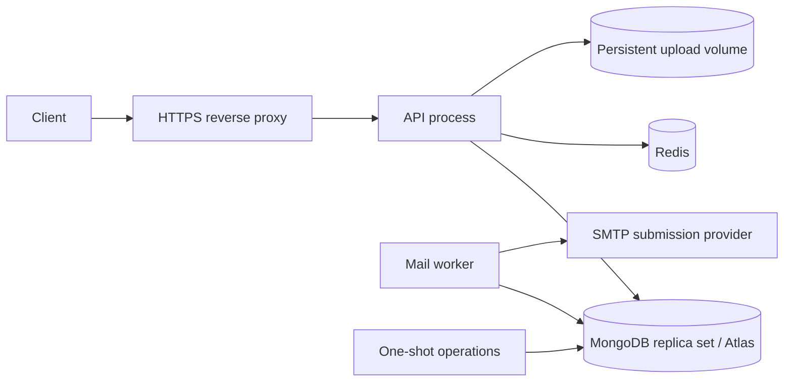

# Deployment and release operations

The repository supplies a production-oriented baseline for an API process and separate mail workers. It does not provision external services, create real credentials, publish an image, deploy a site, or establish production acceptance automatically.

## Topology



API account/token changes and encrypted email jobs commit together in MongoDB. Workers consume only committed jobs. Redis serves API limits/revocation, while durable email work remains in MongoDB. The worker does not require Redis, JWT signing credentials, or upload storage.

MongoDB must be a supported replica set/Atlas deployment. The production Compose file intentionally references external MongoDB, Redis, and SMTP rather than bundling an unauthenticated database or pretending a single container is a highly available database cluster.

## Container artifact

`ops/Dockerfile` uses a multi-stage Node.js 26.13.0 Debian slim image:

- Yarn 4.18.1 from the committed CLI, immutable dependency installation, and separate compilation/production-dependency stages.
- One compiled artifact containing API, worker, and operator commands.
- Production dependencies only; development tsx/compiler/linter are absent at runtime.
- Non-root `node` user, source maps, no embedded `.env`/secrets/uploads.
- Runtime package metadata and license retained for OpenAPI/version information.

The dependency stage copies `.yarnrc.yml` and `.yarn/releases/` explicitly; local caches/install state stay outside the Docker context. Production dependencies are selected with `workspaces focus --all --production` under immutable-install policy and their cache is cleared. Runtime/maintenance commands invoke `node dist/...` directly and do not require the build-stage Yarn release. Normal image installation permits dependency setup scripts for platform/native packages; the local migration used `--mode=skip-build` and did not qualify those scripts or build a container. See [tooling](tooling.md).

`NODE_IMAGE` is a Docker build argument and can be set to an approved digest at release time. The supplied default is version-pinned, not an asserted immutable digest. Pass it explicitly with `docker compose -f ops/compose.production.yml build --build-arg NODE_IMAGE=<approved-image-reference>`; setting a runtime environment variable alone does not override the Dockerfile argument. Container platform/native dependency compatibility remains part of target-environment acceptance.

Compose adds a read-only root filesystem, writable `/tmp`, dropped Linux capabilities, no-new-privileges, PID/memory budgets, rotated JSON logs, init forwarding, and `unless-stopped` restart policies. These are deployment defaults, not a measured capacity qualification.

## Prepare environments and secrets

Copy the three role examples to their untracked runtime names:

```sh
cp ops/environments/api.env.example ops/environments/api.env
cp ops/environments/mail.env.example ops/environments/mail.env
cp ops/environments/database.env.example ops/environments/database.env
```

Configure public API/client URLs, actual provider identity/SMTP settings, trusted proxy addresses, and appropriate pool/concurrency limits. Read [configuration](configuration.md) before changing key lifetimes, token audiences, docs exposure, or lease/shutdown settings.

Provision files listed in [ops/secrets/README.md](../ops/secrets/README.md) through secret management. API and worker use distinct MongoDB URIs, but their queue encryption key and application database must agree. The examples contain no credentials and must not be deployed unchanged.

| Identity             | Needed access                                                                                                           |
| -------------------- | ----------------------------------------------------------------------------------------------------------------------- |
| API MongoDB user     | Account/token/media operations and outbox enqueue/cancellation; no worker-heartbeat administration or routine index DDL |
| Worker MongoDB user  | Read/update outbox and read/write worker heartbeat records; no account/password/media access                            |
| Maintenance operator | Planned collection/index management and legacy/queue administration                                                     |
| API process          | Redis credential and JWT secret                                                                                         |
| Worker process       | SMTP credential                                                                                                         |
| API and worker       | Shared queue encryption key                                                                                             |

Use only the required MongoDB collection actions in custom roles. Automatic Mongoose DDL is disabled in production. MongoDB can implicitly create namespaces on writes, so index provisioning remains a release prerequisite, not a permission guarantee from `autoCreate=false`.

The Compose file mounts local secret files; host permissions must permit container UID/GID 1000 to read them. Local file-backed Compose secrets are not a substitute for an encrypted secret manager. Never commit runtime environment files or secrets; both are excluded from Git and the Docker build context.

## Build and initialize

After provisioning secrets and selecting the target environment:

```sh
docker compose -f ops/compose.production.yml build
# Before accepting any traffic; use the operations database identity:
docker compose -f ops/compose.production.yml --profile operations run --rm operations \
  node dist/app/runtime/commands/database/indexes.js
```

For a 1.x database, stop writers, take restorable backups, prepare legacy records/files, and run the explicit legacy migration before indexes. Follow [migration](migration.md) and [database](database.md), including duplicate-token/attached-avatar reconciliation. Do not run legacy maintenance automatically at container startup or every deploy.

After preparation:

```sh
docker compose -f ops/compose.production.yml up -d api mail-worker
```

`API_IMAGE` names the artifact; its default is `express-mongodb-api:2.0.0`. Prefer building/publishing once and deploying the same reviewed digest in a release pipeline. Building, publishing, and rolling out an image are distinct operations.

The API binds its published port to host loopback (`127.0.0.1:8000` by default). Put a configured HTTPS reverse proxy in front. This example supports one published API instance; multiple API replicas need a load balancer/network configuration rather than reusing the same host port.

## Proxy, docs, and logging

Collect both stdout and stderr: production application logs are sanitized JSON, with errors/warnings on stderr. Bootstrap failures use the independent stderr reporter before clients/logger initialization. Keep file logging disabled in read-only containers unless a writable log volume is deliberately provided. See [runtime diagnostics](logging.md) for codes and stream behavior; proxy/access logs require their own token-URL redaction.

Set `APP_URL`/`CLIENT_URL` to public HTTPS bases. Configure `TRUST_PROXY` with actual proxy addresses/CIDRs as observed in the target network; do not use an unconditional trust value. Verify proxy path rewriting against image URLs and the OpenAPI server base through an explicitly authorized rollout process.

For a public `/api` prefix, Express still receives its unprefixed routes:

| External request                         | Request forwarded to the API         |
| ---------------------------------------- | ------------------------------------ |
| `/api/me`                                | `/me`                                |
| `/api/docs/`                             | `/docs/`                             |
| `/api/openapi.json`                      | `/openapi.json`                      |
| `/api/health/ready`                      | `/health/ready`                      |
| `/api/storage/public/conversions/<file>` | `/storage/public/conversions/<file>` |

Use `APP_URL=https://api.example.com/api` for this mapping, keep `STORAGE_URL=/storage/public`, and configure the proxy to strip exactly the external prefix. The application's own healthcheck uses the internal `/health/ready` path. `CLIENT_URL` supplies the frontend's allowed origin and email-action base, independently of the API prefix.

Keep Swagger disabled publicly by default. If enabling production docs, add dedicated docs credentials (prefer a secret mount with `DOCS_PASSWORD_FILE`) and optionally an internal-network restriction. The base Compose example does not mount a docs password because docs are disabled.

Application logs omit sensitive URL paths, headers, recipient data, and payloads. Reverse-proxy access logs must independently redact one-time token paths, query credentials, and authorization material. Leave `API_LOG_FILENAME` unset in the read-only image; collect both stdout and stderr and monitor [queue signals](operations.md).

## Storage and backups

The named `uploads` volume is mounted only into the API at `/app/storage`. Ensure existing volumes have writable UID/GID ownership before traffic. The worker uses packaged templates and does not need media access. A custom template directory must be deployed read-only with the same definitions/locale resources across the relevant processes.

Back up the database and persistent media together, with separately protected recovery of the queue key. A database restore may revive old queued work: pause workers, assess token expiry/cancellation/idempotency state, and decide what can safely be delivered before resuming. SMTP acceptance cannot be rolled back by restoring MongoDB.

Include a Redis/session-revocation recovery policy and follow the ordered [restore and rollback procedure](operations.md#restore-and-rollback) before resuming delivery.

## Health, scaling, and shutdown

API health checks target `/health/ready`; worker health checks execute the compiled metadata-only `health` command against MongoDB. API readiness reflects MongoDB connection state and Redis readiness, not a fresh end-to-end database operation. Worker health reflects any fresh running worker in the shared database, not that specific container's identity or SMTP availability. Monitor individual replicas as described in [operations](operations.md#worker-heartbeats).

Health failure marks a container unhealthy. Compose restart policy restarts exited processes; it does not repair every unhealthy running process. Route traffic/alerts through suitable external supervision. A healthy worker heartbeat does not prove SMTP delivery.

Scale only after considering provider rate/concurrency quotas and MongoDB pool budgets:

```sh
docker compose -f ops/compose.production.yml up -d --scale mail-worker=2 mail-worker
```

Workers share atomic leases and stable job IDs. Keep clocks synchronized. Grace periods must exceed application drain deadlines. Deploy backward-compatible template/variable schemas for pending jobs, and do not rotate queue keys blindly during a rolling restart.

## Maintenance from the image

```sh
docker compose -f ops/compose.production.yml --profile operations run --rm operations \
  node dist/app/runtime/commands/mail.js stats

docker compose -f ops/compose.production.yml --profile operations run --rm operations \
  node dist/app/runtime/commands/mail.js list --status failed --limit 25
```

The operations service has no restart policy and no public port. Its default command is read-only stats. Index/migration/retry mutations require explicitly selecting those commands. Use the documented exit codes and safe metadata when integrating monitoring or operator tools.

## Release and rollback limits

Version `2.0.0` identifies the prepared source. See the dated [validation status](../README.md#validation-status) for completed local checks and unvalidated environment behavior; it is not a deployment record. Record the released artifact and environment evidence separately using the [handoff guide](handoff.md).

A production rollout still needs its own authorized acceptance, real secrets/services, resource sizing, sender/domain configuration, backup/restore plan, and release ownership. Rolling back binaries does not undo token migrations, new uniqueness constraints, generated image formats, or already sent mail. Keep backups and choose rollback behavior before changing an existing deployment.

## References

- [Docker Compose service settings](https://docs.docker.com/reference/compose-file/services/)
- [Docker build stages](https://docs.docker.com/build/building/multi-stage/)
- [Mongoose transactions](https://mongoosejs.com/docs/transactions.html)
