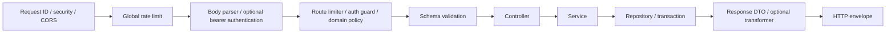

# Developer guide: adding and connecting a domain

This guide follows the project's existing interfaces. It walks through an illustrative `notes` domain: verified accounts create private notes, and authenticated owners read them. **Notes are a documentation example, not an installed feature.** The snippets are intended to be added together; the current API does not expose these endpoints.

[Structure](#choose-the-boundary-and-files) · [Example implementation](#implement-the-domain) · [Registration](#connect-the-domain-to-the-application) · [Extensions](#extend-the-example) · [Handoff](#prepare-the-handoff)

## Choose the boundary and files

Create a domain for a distinct application responsibility with its own rules and public contract. Extend an existing domain when the behavior belongs to it. Keep dependent features inside their owner, as with `auth/verification` and `notifications/delivery`.

Use lowercase filenames and `.ts` relative source imports. Template folders use kebab-case. Add files when they have a responsibility; a small feature does not require every layer, a base repository, classes, interfaces for every function, or a dependency-injection container.

```text
src/domains/notes/
  schemas.ts          Runtime input/output contracts
  dto.ts              Inferred contracts and selected persistence types
  model.ts            MongoDB document shape and justified indexes
  repository.ts       Queries, projections, sessions
  transformer.ts      Only for meaningful conversion or boundary field selection
  service.ts          Business rules and transaction orchestration
  middleware.ts       Route-specific account policy
  controller.ts       HTTP input/context and response envelope
  routes.ts           Routes and middleware order
  documentation.ts    OpenAPI operations using the same schemas
  index.ts            Explicit public domain API
  utils.ts            Only if domain-local helpers are needed
```

The example has no `utils.ts`: there is no helper to extract yet. Keep related types and utilities within their domain rather than introducing global `common`, `shared`, or `types` folders.

`transformer.ts` is optional too. The notes example needs it for ObjectId/date conversion and public-field selection; a feature that only returns already prepared values does not. DTOs stay type declarations in `dto.ts`, derived from runtime schemas. Do not move executable conversion functions into DTO files just to avoid another filename.

Apply the same rule to service methods: keep business orchestration, but avoid `async` functions that only await and return another operation. A public facade can reference a repository function directly if it already returns the intended domain contract. Repository results can be DTOs, booleans, or `void`; they do not need to expose driver results to other domains. See [service/repository boundaries](architecture.md#services-and-repositories).

Controllers are optional files as well. The notes example needs several typed HTTP adapters; a single small catalog/read response can live in `routes.ts`, after its guards, as in the existing notification router. Keep nontrivial input/context adaptation in a controller and business rules in services. Do not introduce a generic controller factory to hide route-specific arguments.

| Layer               | Responsibility                                           | Keep out                                  |
| ------------------- | -------------------------------------------------------- | ----------------------------------------- |
| Schemas / DTOs      | Schemas validate at runtime; DTOs describe parsed types  | Environment loading, database connections |
| Model / repository  | Persist documents, filter ownership, select fields       | Express requests, SMTP submission         |
| Service             | Enforce rules, coordinate domains and transactions       | HTTP response writing                     |
| Transformer         | Select and serialize public fields                       | Database queries and side effects         |
| Controller          | Read validated input/auth context, call service, respond | Raw persistence and transaction logic     |
| Routes / middleware | Order request policies and transport validation          | Business mutation hidden in guards        |
| Documentation       | Describe the actual HTTP behavior                        | Importing services or starting clients    |
| Public index        | Export the small supported domain API                    | Re-exporting every internal module        |

## Request lifecycle



The global middleware order is owned by [`app.ts`](../src/app/http/app.ts). Health, public image conversions, and documentation have their own branches before application authentication. Unhandled application errors reach the final error middleware.

## Implement the domain

All paths below are relative to `src/domains/notes/` unless stated otherwise.

### 1. Define schemas

`schemas.ts` owns runtime validation. Requests cannot choose an owner; the authenticated account supplies it. Response schemas describe JSON values, so timestamps are strings rather than `Date` instances.

```ts
import { z } from 'zod'
import { objectIdSchema } from '../users/schemas.ts'

export const createNoteSchema = z.object({
  title: z.string().trim().min(1).max(120),
  content: z.string().trim().min(1).max(10000)
})

export const noteParamsSchema = z.object({ noteId: objectIdSchema })

export const noteResponseSchema = createNoteSchema.extend({
  id: objectIdSchema,
  createdAt: z.iso.datetime(),
  updatedAt: z.iso.datetime()
})
```

Use refinements for domain-specific constraints and semantic message keys for custom errors. Ordinary Zod objects strip unknown properties in this project; use `z.strictObject` only when rejecting extras is an intentional contract change. A successful parse validates shape, not permission or ownership.

Before adding a schema, check the owning domain's existing contracts. Use an existing schema for an identical request/response shape; derive actual variants with `pick`, `omit`, or `extend`. Reuse a parent feature's public contracts rather than declaring an alias in the child: verification uses auth's `emailRequestSchema` and `tokenParamsSchema` directly. Do not add a global schema folder or merge fields solely because both happen to be strings. Preserve constraints, defaults, transforms, optional/null behavior, refinements, and unknown-key handling when composing schemas.

### 2. Derive DTOs

`dto.ts` derives transport types from schemas. Persistence snapshots use selected native model fields rather than duplicating the document shape or requiring a hydrated document everywhere.

```ts
import type { z } from 'zod'
import type { NoteDocument } from './model.ts'
import type {
  createNoteSchema,
  noteParamsSchema,
  noteResponseSchema
} from './schemas.ts'

export type CreateNoteDto = z.infer<typeof createNoteSchema>
export type NoteParamsDto = z.infer<typeof noteParamsSchema>
export type NoteResponseDto = z.infer<typeof noteResponseSchema>
export type NoteRecordDto = Pick<
  NoteDocument,
  '_id' | 'title' | 'content' | 'createdAt' | 'updatedAt'
>
```

`z.infer` describes parsed output. For a contract with coercion/defaults/transforms, use `z.input` when describing values before parsing and `z.output`/`z.infer` for service input after parsing. Type annotations alone do not validate runtime data.

For example, `SendTemplateDto` uses `z.input<typeof notificationSchema>` so callers can omit defaulted variables; `PreparedNotificationDto` describes the prepared payload with variables present and a canonical selected language. `EnqueueOptionsDto` and `DeliveryListOptionsDto` also describe pre-parse options, not the parsed result. Keep defaults on the schema instead of making the DTO independently optional.

Do not add another DTO solely to rename an existing shape: sign-in/email-change share `CredentialsDto`, reset/verification requests share `EmailRequestDto`, and profile updates reuse `UpdateProfileDto` for the result. Export only supported, used contracts. Native model snapshots, sessions, Express/OpenAPI adapters, and Zod validator instances use library types; fake `z.custom` schemas would not add validation. See [schema ownership](architecture.md#schema-and-dto-ownership) for the complete rules.

### 3. Define persistence

`model.ts`:

```ts
import { model, Schema } from 'mongoose'
import type { HydratedDocument, InferSchemaType } from 'mongoose'

const schema = new Schema(
  {
    owner: { type: Schema.Types.ObjectId, required: true, ref: 'User' },
    title: { type: String, required: true, trim: true, maxlength: 120 },
    content: { type: String, required: true, trim: true, maxlength: 10000 }
  },
  { timestamps: true, collection: 'notes' }
)

schema.index({ owner: 1 })

export type NoteDocument = HydratedDocument<InferSchemaType<typeof schema>>
export const Note = model('Note', schema)
```

The example's point lookup uses MongoDB's existing unique `_id` index; another owner/ID compound index is unnecessary for that lookup. The separate owner index supports account-wide cleanup through `deleteOwned`. Add indexes for implemented access paths, then update index provisioning. Mongoose `ref` is metadata, not a foreign-key or ownership constraint.

Keep schema construction simple so Mongoose infers timestamps and fields. If adding a `toJSON` transform, configure it with `schema.set('toJSON', ...)` after constructing the schema, as in the existing user model. Choose HTTP response fields explicitly; put meaningful format conversion in a transformer when needed, and keep the common HTTP envelope in `app/http/response.ts`.

### 4. Keep database operations in the repository

`repository.ts`:

```ts
import type { ClientSession } from 'mongoose'
import { Note } from './model.ts'
import type { CreateNoteDto } from './dto.ts'

export const noteRepository = {
  create: (ownerId: string, payload: CreateNoteDto, session: ClientSession) =>
    new Note({
      owner: ownerId,
      title: payload.title,
      content: payload.content
    }).save({ session }),

  getOwned: (id: string, ownerId: string) =>
    Note.findOne({ _id: id, owner: ownerId })
      .select('_id title content createdAt updatedAt')
      .lean()
      .exec(),

  async deleteOwned(ownerId: string, session: ClientSession): Promise<void> {
    await Note.deleteMany({ owner: ownerId }, { session }).exec()
  }
}
```

Ownership is part of the database filter. An absent note and another account's note both produce a missing result. Use explicit update fields and `runValidators: true` for future updates; do not pass `req.body`, `req.query`, or arbitrary client filter objects into Mongoose.

Lean projections are suitable for read snapshots. They do not apply document getters/defaults/transforms as a substitute for a DTO transformer. Pass the caller's session to every operation participating in its transaction.

### 5. Serialize with a transformer

`transformer.ts`:

```ts
import type { NoteRecordDto, NoteResponseDto } from './dto.ts'

export const toNoteResponseDto = (note: NoteRecordDto): NoteResponseDto => ({
  id: note._id.toString(),
  title: note.title,
  content: note.content,
  createdAt: note.createdAt.toISOString(),
  updatedAt: note.updatedAt.toISOString()
})
```

Select fields explicitly. Avoid returning documents or spreading their contents into public responses; persistence fields added later should not become public automatically. Use `transformer.ts`, not `mapper.ts`.

This example warrants a named transformer because it converts ObjectId and Date values and omits the owner/document metadata. A simple token result instead belongs directly in its producer:

```ts
// In a function with an AccessTokenDto return type:
return { accessToken }
```

Do not add a `toAccessTokenDto(accessToken)` wrapper or an empty transformer file for this case. For a small field-only response, assemble the documented fields inline; retain a dedicated transformer when a shared persistence/public boundary needs an explicit allowlist. See the current [transformer decision rules](architecture.md#when-a-transformer-is-useful).

### 6. Coordinate rules in the service

`service.ts`:

```ts
import { database } from '../../app/database/mongodb.ts'
import { AppError } from '../../app/http/errors.ts'
import { userService } from '../users/index.ts'
import type { AccountDto } from '../users/dto.ts'
import { noteRepository } from './repository.ts'
import { toNoteResponseDto } from './transformer.ts'
import type { CreateNoteDto, NoteResponseDto } from './dto.ts'

export const noteService = {
  async create(
    user: AccountDto,
    payload: CreateNoteDto
  ): Promise<NoteResponseDto> {
    return database.transaction(async session => {
      const current = await userService.lockCurrent(user, session)
      if (!current.verified)
        throw new AppError(403, 'notes.verification_required')
      const note = await noteRepository.create(current.id, payload, session)
      return toNoteResponseDto(note)
    })
  },

  async getOwned(user: AccountDto, id: string): Promise<NoteResponseDto> {
    const note = await noteRepository.getOwned(id, user.id)
    if (!note) throw new AppError(404, 'notes.not_found')
    return toNoteResponseDto(note)
  },

  deleteOwned: noteRepository.deleteOwned
}
```

The mutation rechecks the current account/version under the existing account lock. The verified-account rule is enforced here even when code calls the service without HTTP middleware. Reads retain owner filtering.

`deleteOwned` uses a direct function reference because it adds no policy or orchestration. The repository deliberately discards the native delete result. `create` and `getOwned` retain service logic for the verified-account rule, transaction, ownership outcome, and response conversion. Avoid adding another pass-through method for each repository operation by convention.

Use one transaction owner for a workflow. Internal participating operations accept its session instead of starting nested transactions. Driver transaction callbacks can repeat: keep SMTP, filesystem deletion, remote APIs, and other irreversible effects outside them. Related email work goes into the transactional outbox.

### 7. Add a domain middleware policy

`middleware.ts`:

```ts
import type { NextFunction } from 'express'
import type { ApiRequest, ApiResponse } from '../../app/http/dto.ts'
import { AppError } from '../../app/http/errors.ts'
import { getAuth } from '../auth/index.ts'

export const requireVerifiedAccount = (
  _req: ApiRequest,
  res: ApiResponse,
  next: NextFunction
) => {
  if (!getAuth(res).user.verified) {
    throw new AppError(403, 'notes.verification_required')
  }
  next()
}
```

The guard rejects an unsuitable request early; the service still owns the mutation rule. Call `next()` once on success, or throw/finish the response. Do not mutate account data inside an authorization middleware.

There is no generic roles/permissions framework in the current account model. If a new domain needs one, define its actual policy and contract; do not assume an `isAdmin` middleware exists.

### 8. Adapt HTTP in the controller

`controller.ts`:

```ts
import type { ApiRequest, ApiResponse } from '../../app/http/dto.ts'
import { respond } from '../../app/http/response.ts'
import { getAuth } from '../auth/index.ts'
import { noteService } from './service.ts'
import type { CreateNoteDto, NoteParamsDto, NoteResponseDto } from './dto.ts'

export const noteController = {
  async create(
    req: ApiRequest<CreateNoteDto>,
    res: ApiResponse<NoteResponseDto>
  ) {
    const note = await noteService.create(getAuth(res).user, req.body)
    respond(res, 'notes.created', note)
  },

  async getOwned(
    req: ApiRequest<unknown, NoteParamsDto>,
    res: ApiResponse<NoteResponseDto>
  ) {
    const note = await noteService.getOwned(
      getAuth(res).user,
      req.params.noteId
    )
    respond(res, 'notes.loaded', note)
  }
}
```

Use `getAuth(res)` rather than decoding JWTs again. `respond` in `app/http/response.ts` creates the standard envelope; the service result is the `data` field. `createErrorResponse` centralizes error envelopes, and `toValidationIssueDto` in `app/http/transformer.ts` converts Zod issues into safe field details. Express 5 routes forward rejected async handlers to the error middleware; do not add a redundant async-wrapper abstraction or catch every error into HTTP `200`.

The signature is `respond(res, messageKey, data?, status = 200)`. The semantic key is required; a no-data operation awaits its business work and then calls `respond(res, 'notes.completed')`. Do not pass a service promise as data or send success before the mutation finishes. Other non-200 success contracts can pass a fourth argument, but must be reflected in OpenAPI too.

The example uses the default `200` to match the existing `operation()` documentation helper. If choosing `201` or `204` for a new contract, extend response/documentation behavior as part of that change: the helper currently documents a literal `200` success envelope, and `respond` writes JSON rather than implementing a separate bodyless-204 path.

### 9. Compose the routes

`routes.ts`:

```ts
import { Router } from 'express'
import { validateRequest } from '../../app/http/middlewares/schema.ts'
import { authGuard } from '../auth/index.ts'
import { noteController } from './controller.ts'
import { requireVerifiedAccount } from './middleware.ts'
import { createNoteSchema, noteParamsSchema } from './schemas.ts'

export const createNoteRouter = () => {
  const router = Router()
  router.post(
    '/notes',
    authGuard.isAuth,
    requireVerifiedAccount,
    validateRequest(createNoteSchema),
    noteController.create
  )
  router.get(
    '/notes/:noteId',
    authGuard.isAuth,
    validateRequest(noteParamsSchema, 'params'),
    noteController.getOwned
  )
  return router
}
```

The global auth middleware resolves an optional bearer JWT; `authGuard.isAuth` makes authentication mandatory for these routes. Public routes omit that guard. Guest-only routes use `authGuard.isGuest`. Invalid supplied credentials are rejected globally even for public application endpoints.

`isAuth` and controllers share the `getAuth` presence check; the guard still belongs before validation/controller execution. Keep the signature adapter that calls `next()` after a successful check. Do not broaden route-specific guards/limiters with a shared prefix if that would affect unrelated methods, routes, or unknown paths.

`validateRequest(schema)` parses and replaces `req.body`. The `params` variant validates but does not replace `req.params`; avoid depending on parameter coercions/defaults unless you explicitly consume their parsed output. Query parsing is described below.

### 10. Describe the HTTP contract

`documentation.ts`:

```ts
import { operation } from '../../app/http/documentation/utils.ts'
import type { OpenApiPathsDto } from '../../app/http/documentation/dto.ts'
import {
  createNoteSchema,
  noteParamsSchema,
  noteResponseSchema
} from './schemas.ts'

export const createNoteDocumentation = (): OpenApiPathsDto => ({
  '/notes': {
    post: operation({
      operationId: 'createNote',
      summary: 'Create a private note',
      description:
        'Requires a verified account. Owner identity comes from the JWT.',
      tag: 'Notes',
      access: 'authenticated',
      body: createNoteSchema,
      response: noteResponseSchema,
      messageKey: 'notes.created',
      errors: [403]
    })
  },
  '/notes/{noteId}': {
    get: operation({
      operationId: 'getOwnedNote',
      summary: 'Read an owned note',
      description:
        'Missing notes and notes owned by another account both return 404.',
      tag: 'Notes',
      access: 'authenticated',
      params: noteParamsSchema,
      response: noteResponseSchema,
      messageKey: 'notes.loaded',
      errors: [404]
    })
  }
})
```

Express uses `:noteId`; OpenAPI uses `{noteId}`. Pass the same `noteParamsSchema` to route validation and the helper's `params`; path parameter definitions are derived from its fields without mutating a generated operation. Use globally unique `operationId` values and review path placeholders against the schema keys.

The required `access` mode describes the actual middleware: `authenticated` for `isAuth`, `guest` for `isGuest`, and `public` for optional-auth application handlers. Public operations allow anonymous access or a valid bearer token; malformed supplied credentials still fail globally. Guest-only policy contributes `403` automatically; other domain-specific `403`, `404`, and `409` outcomes must be declared explicitly. Shared parser/auth/limiter failures are included by the helper.

`body` describes the current JSON and flat URL-encoded parsers. Use an explicit native `requestBody` for multipart or a custom/JSON-only contract; it cannot be combined with `body`. The upload operation is the concrete multipart example. `response` describes the emitted data, not its envelope; the helper generates the existing literal-200 envelope in Zod output mode. Dates in JSON response schemas must therefore be ISO strings, and normalization transforms need a representable output contract. The shared `jsonResponse` helper describes raw health payloads rather than another business response envelope.

Keep schema conversion inside documentation factories so importing a module does not eagerly generate a spec. Documentation imports schemas/DTOs and helpers, not services, repositories, environment loaders, or client connections. Auth documentation composes its verification feature, so root assembly registers the parent only. JSON Schema does not express every semantic refinement; describe ownership and workflow rules in prose.

### 11. Export the supported domain API

`index.ts`:

```ts
export { noteService } from './service.ts'
export type { CreateNoteDto, NoteResponseDto } from './dto.ts'
```

Other domains import `noteService` from `../notes/index.ts`. They can import public DTO/schema contracts directly, but not another domain's model, repository, controller, middleware, transformer, or helpers. HTTP composition and administrative maintenance have explicit adapter access.

The boundary rules live in [`eslint.config.mjs`](../eslint.config.mjs). When introducing a top-level domain, update the enumerated domain names in the nested-feature restriction as well as observing the generic sibling-domain restrictions. Avoid importing the public index from inside its own domain when a direct local import suffices.

## Connect the domain to the application

There is no automatic module discovery. Creating files alone does not register routes, documentation, database maintenance, or account cleanup.

| Integration                   | Owning file                                                                                       | Required change                                                                                                                       |
| ----------------------------- | ------------------------------------------------------------------------------------------------- | ------------------------------------------------------------------------------------------------------------------------------------- |
| HTTP router                   | [`src/app/http/router.ts`](../src/app/http/router.ts)                                             | Import `createNoteRouter` and add `createNoteRouter()` to the existing `router.use(...)` call                                         |
| OpenAPI                       | [`src/app/http/documentation/document.ts`](../src/app/http/documentation/document.ts)             | Import the factory, spread `...createNoteDocumentation()` into `paths`, add a `Notes` tag                                             |
| Collection/index provisioning | [`src/app/runtime/commands/database/indexes.ts`](../src/app/runtime/commands/database/indexes.ts) | Import `Note` and include it in the collection/index creation loop; add conflict preflights if adding uniqueness constraints          |
| Account lifecycle             | [`src/domains/auth/service.ts`](../src/domains/auth/service.ts)                                   | For this example's deletion policy, call `noteService.deleteOwned(user.id, session)` inside the existing account-deletion transaction |
| Domain boundaries             | [`eslint.config.mjs`](../eslint.config.mjs)                                                       | Include `notes` in the nested cross-domain restriction's domain-name alternatives                                                     |
| Client messages               | Client-owned translation dictionaries                                                             | Add success/error keys and an unknown-key fallback                                                                                    |
| Guides                        | [Database](database.md), [architecture](architecture.md), [changelog](../CHANGELOG.md)            | Record the new domain, collection/index behavior, API changes, and migration requirements                                             |

Do not replace existing router registrations or overwrite the assembled OpenAPI `paths`. Merge new paths carefully; object spreads with duplicate path keys overwrite earlier entries, even when the intended HTTP methods differ. Compose shared path items explicitly when extending an existing URL.

For example, the complete HTTP composition in `src/app/http/router.ts` becomes:

```ts
import { Router } from 'express'
import type { RequestHandler } from 'express'
import { createAuthRouter } from '../../domains/auth/routes.ts'
import { createUserRouter } from '../../domains/users/routes.ts'
import { createMediaRouter } from '../../domains/media/routes.ts'
import { createNotificationRouter } from '../../domains/notifications/routes.ts'
import { createNoteRouter } from '../../domains/notes/routes.ts'

export const createRouter = (authRateLimit: RequestHandler) => {
  const router = Router()
  router.use(
    createAuthRouter(authRateLimit),
    createUserRouter(),
    createMediaRouter(),
    createNotificationRouter(),
    createNoteRouter()
  )
  return router
}
```

The routes already contain `/notes`, so mounting the router again under `/notes` would duplicate the prefix. For a prefix-based router instead, make its internal paths relative and use one consistent mounting convention.

For the example, client dictionaries need `notes.created`, `notes.loaded`, `notes.not_found`, and `notes.verification_required`, alongside existing validation/auth keys. API keys are not added to server email dictionaries.

Choose a deletion/retention policy before exposing the domain to real users. The example deletes notes with the account; its repository helper is intended for that existing transaction, not a public delete-all endpoint. Provision the declared owner index along with the collection. Account locks coordinate participating application writers, not external tools that ignore the protocol.

## Extend the example

### Query parameters and pagination

The shared `validateRequest` currently accepts only `body` and `params`. For a listing route, add a local query schema and inferred DTO, explicitly parse `req.query`, map failures with `toValidationIssueDto`, and pass `parsed.data` to the service. Express query properties should not be reassigned to stash parsed output.

For example, a bounded pagination contract in `schemas.ts` could be:

```ts
export const noteListQuerySchema = z.object({
  limit: z.coerce.number().int().min(1).max(100).default(25),
  cursor: z.string().max(512).optional()
})
```

An opaque cursor still needs decoded structural validation and binding to the intended filters. Follow the existing [`delivery/operations.ts`](../src/domains/notifications/delivery/operations.ts) implementation for cursor parsing and `(createdAt, _id)` ordering. Use deterministic sorting, projections, a bounded page size, and a matching index. Do not add an unbounded `find()` or deep `skip()` pagination as a default.

### Local utilities

Put small reusable domain helpers in `utils.ts` when they have more than a trivial call-site expression. Keep their parameters/results explicit, infer contract types in `dto.ts`, and avoid importing controllers or starting clients inside helpers. A helper used by another domain should be exposed through a deliberate public API or moved to the application concern that actually owns it. Do not collect unrelated functions in a global utility folder.

Name substantial adapters/workflows by responsibility: the current project uses `media/image.ts` for image I/O and `notifications/preparation.ts` / `renderer.ts` for notification processing. Pure language matching remains in notification-local `utils.ts`; SMTP failure classification belongs to `mailer.ts`, and retry timing is private to the worker. See the [module ownership map](architecture.md#utilities-and-ownership).

Before extracting a helper, distinguish shared policy from a forwarding wrapper. A configured password work factor or a token's entropy/expiry construction merits one definition. A one-use header regex or a function that merely assembles already prepared fields can stay at its call site. Do not move unrelated hashing protocols or historical migrations into a global crypto abstraction solely because they use the same Node primitive.

For file adapters, reuse `resolveWithinRoot` from `app/runtime/paths.ts` for lexical root containment and keep domain-specific roots/error responses in the domain. Do not duplicate containment conditions or relax them for a new folder. The primitive does not provide symlink resolution or arbitrary client-file access.

### Middleware placement and rate limits

| Concern                                           | Placement                                                    |
| ------------------------------------------------- | ------------------------------------------------------------ |
| Request IDs, security headers, CORS, body parsing | Existing global composition in `app/http/app.ts`             |
| JWT decoding/revocation/account version           | Existing global `authMiddleware`; do not mount a second copy |
| Mandatory login / anonymous-only action           | Route `authGuard.isAuth` / `authGuard.isGuest`               |
| Feature policy                                    | Local `middleware.ts`, plus service checks where needed      |
| Input contracts                                   | Route validation, before the controller                      |
| Expensive or sensitive endpoints                  | Explicit route limiter before expensive work                 |
| Error serialization                               | Existing final error middleware                              |

All normal application routes already receive the global Redis-backed limiter. The sensitive auth limiter is passed through `createRouter(authRateLimit)`. A domain can accept a `RequestHandler` in its router factory for an intentional limiter; a new policy needs its own configured Redis key prefix and bounds. Do not reuse the auth limit accidentally or introduce per-instance memory limits for a horizontally scaled service.

Throw `AppError(status, 'domain.message_key')` for expected failures. For custom validation details, use the established `{ path, messageKey, params? }` contract. Unknown failures become generic `500` responses; do not leak provider errors, query values, credentials, raw documents, or stack traces to clients.

### Background notifications and templates

Use the public `notificationService.enqueueTemplate` API from `../notifications/index.ts`. Register the server-owned template and variable schema first, using the [custom-template guide](notifications.md#registering-custom-html) and [template catalog](../src/domains/notifications/templates/README.md).

For a business mutation that must create an email job, enqueue it **inside the same transaction**, passing its session. For example, after creating a note and resolving `current` under the account lock:

```ts
await notificationService.enqueueTemplate(
  {
    template: 'noteCreated',
    email: current.email,
    language,
    variables: { title: note.title }
  },
  { session, options: { ownerId: current.id, purpose: 'custom' } }
)
```

This extension requires registering `noteCreated`, forwarding an optional `language` parameter through the controller/service, and importing `notificationService`. The base example does not send emails. Accept recipients and template keys from trusted business logic; do not create an arbitrary public HTML/email relay.

Pass `req.get('Accept-Language')` for request-triggered email and an explicit locale for background workflows. Custom template definitions must be available to every producer and worker; process-local registration in only the API is insufficient. Deploy compatible templates for retained/retrying jobs. SMTP belongs to the delivery worker, never the request transaction. See [operations](operations.md) for delivery recovery and diagnostics.

Set `emailLanguage: true` when the handler forwards Accept-Language for email selection. This flag documents only the header; write accurate transaction, no-op, and asynchronous-delivery behavior in the operation's own description. A language preference does not itself guarantee a queued email or SMTP delivery.

### Configuration and process resources

New settings belong in `app/config/schemas.ts` and the narrow profile that needs them. Profile types are inferred from `loadEnvironment`; no parallel environment DTO needs updating. Update `.env.example`, relevant `ops/environments/*.env.example`, secret-file allowlist if applicable, and [configuration](configuration.md). A new setting is not automatically made available to a profile by adding it to the base schema.

Keep API-only credentials out of worker/diagnostic profiles. Do not read `process.env` independently in controllers. If adding a long-lived client or worker, connect it in its owning runtime, drain/close it on signals and failure, and document readiness, timeouts, and supervisor behavior. Source imports must not start extra background loops as a side effect.

Use `bootstrap(component, () => import('./implementation.ts'))` for a new process entrypoint so configuration/import failures reach the safe stderr reporter. Add only that process's configuration loaders to `app/config/process.ts`; help-only and pure-export paths must stay credential-free. Put client imports inside the implementation, after configuration preparation.

For exception logging, import `errorDiagnostic` from `app/runtime/diagnostics/diagnostic.ts` and combine it with explicit component/stage/request/job metadata. Use static log titles, matched route patterns, and safe IDs. Do not pass raw errors, request objects, URLs, message bodies, or driver responses. Authored operational failures can use `DiagnosticError`; its reason/hint must not come from rejected values or exception messages. See [logging](logging.md) for source-stack and redaction boundaries.

### Database evolution and other side effects

Additive index provisioning does not migrate existing records or remove obsolete indexes. Prepare explicit data migrations, duplicate handling, and rollback implications for populated collections. Update the existing operator entrypoints rather than adding schema changes to application startup. Never infer that declaring an index has deployed it.

Model external work according to its failure/recovery needs. Do not assume the SMTP outbox is a generic durable job executor for payments, webhooks, filesystem cleanup, or arbitrary code; those handlers do not exist. Small synchronous operations need no invented queue or abstraction. Document best-effort behavior when that is the actual guarantee.

## Prepare the handoff

Before considering a new domain integrated, review the complete path: schemas → DTOs → repository/model → transformation when needed → service → controller/middleware → route registration → OpenAPI registration → indexes/data lifecycle → client message keys. This is a responsibility review, not a requirement to create every file.

Provide a concrete request/response example, required configuration and data preparation, permission/ownership rules, failure outcomes, operator actions, and known limitations. Use the [QA and release handoff guide](handoff.md) to record what was actually checked. Example code in this document has not been added to the application or independently compiled/executed.
