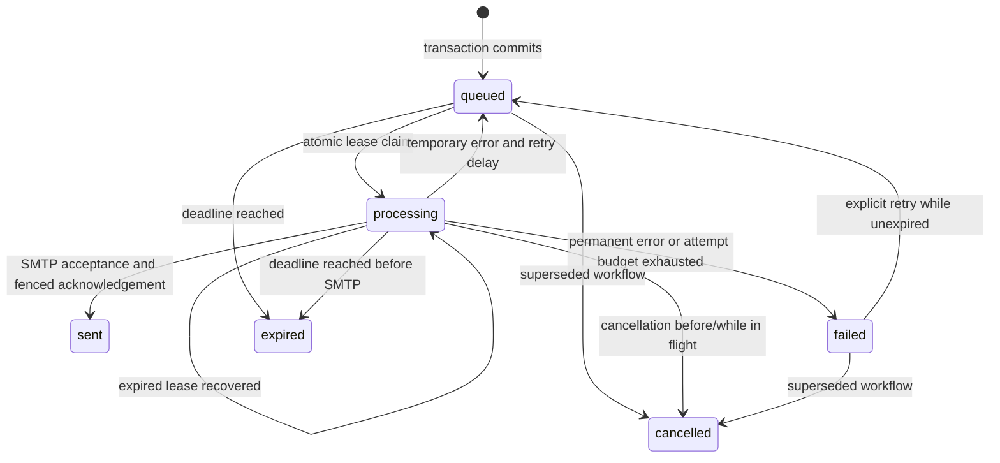

# Queue administration and observability

Queue commands are operator tools. They do not expose a public mail relay or an unauthenticated administration API. Default output is JSON metadata: no email addresses, tokens, ciphertext, fingerprints, or rendered content.

Development uses `yarn mail:queue`; production uses `yarn mail:queue:prod`. Both accept the same arguments. Compiled commands are included in the production image and do not require tsx or other development dependencies.

## Commands

```sh
yarn mail:queue --help
yarn mail:queue stats
yarn mail:queue list --status failed --limit 25
yarn mail:queue list --status failed --limit 25 --cursor '<nextCursor>'
yarn mail:queue show --id '<delivery-id>'
yarn mail:queue workers
yarn mail:queue health
# Explicit mutation:
yarn mail:queue retry --id '<delivery-id>'
```

`--help` needs no environment/database credentials. Other commands require only MongoDB configuration (including a file-backed URI) and operational delivery settings. They do not import API/JWT/Redis/SMTP configuration or payload-decryption helpers. Automatic model DDL is forced off.

| Command   | Result                                                                                                       | Effects                                                                                  |
| --------- | ------------------------------------------------------------------------------------------------------------ | ---------------------------------------------------------------------------------------- |
| `stats`   | Counts for all six job states, due queue size, expired leases, oldest queued age, fresh running-worker count | Read-only; no cross-query transaction, so counts are an approximate operational snapshot |
| `list`    | Bounded status-filtered items plus optional opaque `nextCursor`                                              | Read-only; default status `failed`, default limit 25, maximum 100                        |
| `show`    | One delivery DTO or `null`                                                                                   | Read-only                                                                                |
| `workers` | Up to 100 recent workers: ID, status, concurrency, active jobs, timestamps, staleness                        | Read-only                                                                                |
| `health`  | `{ status: 'ready' }` or `{ status: 'unavailable' }`                                                         | Read-only; checks for at least one fresh `running` worker                                |
| `retry`   | Requeued delivery DTO or `null`                                                                              | Resets one unexpired failed job's attempt budget; existing workers can send it afterward |

Exit codes: **0** for success; **1** for invalid arguments/configuration/command failure; **2** for unavailable worker health, missing delivery, or a retry-ineligible job. Unknown options are rejected. Delivery IDs must be producer UUIDs or SHA-256 idempotency IDs. Cursor JSON is validated after decoding and uses a `(createdAt, _id)` position; keep the same status between pages.

For machine-readable stdout in automation or runtime containers, invoke the compiled command directly after building, independently of package-manager launcher behavior:

```sh
node dist/app/runtime/commands/mail.js stats
node dist/app/runtime/commands/mail.js list --status failed --limit 25
```

Separate stdout JSON from stderr diagnostics and inspect the exit code. Configuration/import/argument failures use the shared bootstrap reporter before a result object exists: readable blocks in development, JSON in production. Do not assume a failure produces a stdout result. Queue help still needs no credentials and valid commands validate only MongoDB/delivery profiles. See [runtime diagnostics](logging.md). `retry` is an intentional mutation against the selected environment and can result in an actual email.

### Interpreting counters

`counts` covers all six persisted states. `dueQueued` counts queued records with `availableAt <= now`, including records whose expiry still needs worker handling. `expiredLeases` counts processing records eligible for recovery; it is not a count of confirmed lost emails. `oldestQueuedAgeMs` measures age since job creation, including delayed retries, and is `null` for an empty queue. Counts are a multi-query snapshot and can change while workers are active.

## Job states



Retries use exponential ceilings with equal jitter. Processing counters include started processing attempts, including recovery; the final budget-exhaustion recovery does not start another SMTP attempt. Permanent failures and configuration/render/decryption errors require repair before manual retry. The queue cannot retract SMTP traffic already in flight, and uncertain acceptance may lead to a duplicate with the same Message-ID.

## Worker heartbeats

Each process registers a UUID in `email_workers` before claiming jobs. Heartbeats publish `running`, `draining`, or `stopped`, start/last-seen timestamps, configured concurrency, and active-job count. They contain no hostnames, credentials, recipients, or content.

Defaults:

- `MAIL_WORKER_HEARTBEAT_MS=10000`.
- `MAIL_WORKER_STALE_MS=45000`; must allow at least three heartbeat intervals.
- Old records receive a TTL deadline ten stale intervals after their last report.

Health uses the freshness cutoff immediately, without waiting for asynchronous TTL cleanup. Clock synchronization is required across processes. A fresh worker heartbeat confirms its loop/database reachability, not SMTP acceptance or inbox delivery. A fresh running worker can still encounter permanent provider errors, so monitor job failures separately.

The `health` command reports whether **any** fresh running worker exists in the configured database. It does not identify the calling container or prove that each replica is consuming. Another healthy worker can mask a stalled individual process; compare recent worker IDs/counts with the expected replica count and use process/container supervision as well.

## Signals and shutdown

API shutdown stops accepting HTTP traffic, drains requests, and closes MongoDB/Redis within `SHUTDOWN_TIMEOUT_MS`. Worker shutdown stops new claims, marks the process draining, waits for active work, stops heartbeat reporting, marks it stopped, closes SMTP, and disconnects MongoDB. The deadline is `MAIL_WORKER_SHUTDOWN_TIMEOUT_MS`.

The Compose grace periods exceed the sample application deadlines (API 30s versus 10s; worker 90s versus 60s). Keep them aligned when tuning. If hard termination interrupts delivery, lease expiry makes the job recoverable. This preserves work but cannot establish exactly-once SMTP delivery.

## Monitoring and recovery

Collect both stdout and stderr (structured JSON in production) and alert on sustained changes rather than a single transient retry. The [diagnostic reference](logging.md) covers startup/configuration, HTTP failures, dependency recovery, and safe source stacks:

| Signal                       | Interpretation / response                                                                                                   |
| ---------------------------- | --------------------------------------------------------------------------------------------------------------------------- |
| No fresh running worker      | Inspect supervisor/container state and MongoDB connectivity; restore workers before backlog ages out                        |
| Oldest queued age rising     | Capacity/provider/concurrency issue; compare volume and SMTP limits before scaling                                          |
| Terminal failures increasing | Inspect safe error categories; fix credentials, recipient policy, renderer/schema compatibility, or encryption-key mismatch |
| Expired leases increasing    | Crashes, event-loop stalls, clock skew, database loss, or shutdown deadlines too short                                      |
| Queued jobs expiring         | Delivery latency exceeded the job/token window; fix availability and request fresh security links where necessary           |

Use job IDs and request/worker log context, not raw recipient/token logging. API readiness covers MongoDB/Redis only. Compose health checks mark containers unhealthy; Docker restart policy restarts exited containers, not unhealthy-but-running containers. External supervision/alerting is needed for persistent unhealthy status.

## Recovery sequence

1. Identify the environment and affected job IDs using metadata commands.
2. Repair the cause before retrying; verify key/config/template compatibility through your authorized operational process.
3. Retry only eligible failed jobs. Expired/cancelled work needs a new business action, especially security tokens.
4. Remember uncertain SMTP acceptance can already have delivered the original email.
5. Observe subsequent state/error trends. Do not repeatedly reset the budget to mask an unresolved provider problem.

Failed encrypted payloads and operational metadata have bounded retention. There is no bulk resend-all command or arbitrary public HTML-sending endpoint.

## Delivery error categories

`lastErrorCode` is a safe operational category, not the original provider response or recipient data:

| Code                       | Worker behavior / operator action                                                                                         |
| -------------------------- | ------------------------------------------------------------------------------------------------------------------------- |
| `smtp.connection`          | Retryable network/submission failure within attempt/deadline bounds; inspect connectivity and provider availability       |
| `smtp.temporary`           | Temporary provider failure; bounded retry with jitter                                                                     |
| `smtp.permanent`           | Terminal provider/envelope failure; investigate the business/provider cause before considering a retry                    |
| `smtp.configuration`       | Terminal authentication/TLS/configuration category; repair worker/provider settings first                                 |
| `render.failed`            | Terminal template/schema/translation/rendered-content failure; restore compatible definitions/files/dictionaries          |
| `payload.invalid`          | Terminal missing/decryption payload failure; check the original queue key and record/artifact compatibility               |
| `queue.attempts_exhausted` | Recovery found the attempt budget already consumed; do not repeatedly reset it without resolving uncertain delivery/cause |

Retryable failures can still end in `failed` when the budget is exhausted or `expired` when no valid retry window remains. A record can expire without an SMTP attempt. Failed records are retry-eligible only while unexpired and while their encrypted payload remains present.

## Incident response

| Situation                     | Immediate response                                                                         | Recovery boundary                                                                                 |
| ----------------------------- | ------------------------------------------------------------------------------------------ | ------------------------------------------------------------------------------------------------- |
| MongoDB unavailable           | Restore database access; keep dependent traffic/work under supervision                     | API readiness/worker state do not prove transaction success; reconcile ambiguous client mutations |
| Redis unavailable             | Restore Redis before relying on protected API traffic                                      | Limits fail closed; lost revocation records need a session-recovery policy                        |
| SMTP unavailable              | Inspect queue age/errors and provider connectivity; avoid unnecessary manual resets        | Existing temporary failures retry only within their original budget/deadline                      |
| Incorrect template deployment | Stop affected workers while restoring compatible template definitions/assets               | Already accepted mail cannot be retracted; retained jobs must still match their schemas           |
| Queue key lost or changed     | Stop workers, recover the original key through secret recovery, keep producers coordinated | There is no built-in multi-key decryption or automatic ciphertext migration                       |
| Pending work reaches expiry   | Restore availability and initiate fresh business/security-link actions as needed           | `expired`/`cancelled` jobs are not revived by the retry command                                   |

Do not disable expiry, remove ownership/lease predicates, reset every job, or create a second key merely to clear an incident. Record the affected artifact, environment, safe IDs, times, repair, and remaining uncertain acceptance in the [handoff record](handoff.md#record-results).

## Restore and rollback

A restore is a coordinated data, secret, file, and delivery decision. The repository provides no automated restore/resend command.

1. Stop API/worker processes and other writers. Preserve the current incident state and choose a compatible application artifact before replacing data.
2. Restore the intended database and matching private originals/conversions, with appropriate filesystem ownership. Recover the corresponding queue key separately; restoring ciphertext without its key cannot recover payloads.
3. Review restored account/token validity, indexes, and queued/processing/failed work while workers remain stopped. A backup may predate cancellation or an acknowledgement even when SMTP already accepted the message.
4. Review Redis revocation state. Restoring/clearing Redis can lose sign-out records while JWTs remain otherwise valid; decide whether the session policy requires invalidating existing credentials. A planned JWT-signing-key change is separate from the persistent queue encryption key.
5. Decide which work remains deliverable under its original token/job expiry and current business state. Use the owning business workflow for fresh links; avoid blind bulk replay. Data/index changes and sent mail are not reversed by rolling back binaries.
6. Resume only compatible producers/workers after the agreed acceptance steps. Observe queue age, failures, worker freshness, API readiness, and media access; record actual results and unresolved uncertainty.

Backups and recovery procedures should identify the artifact, schema/index state, storage snapshot, secret recovery path, Redis/session policy, and responsible operator. Provider delivery/bounce records may be needed to investigate SMTP acceptance outside the restored database.
